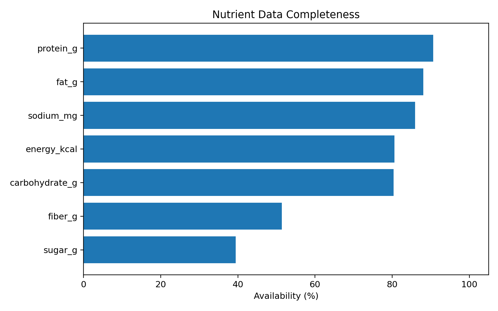
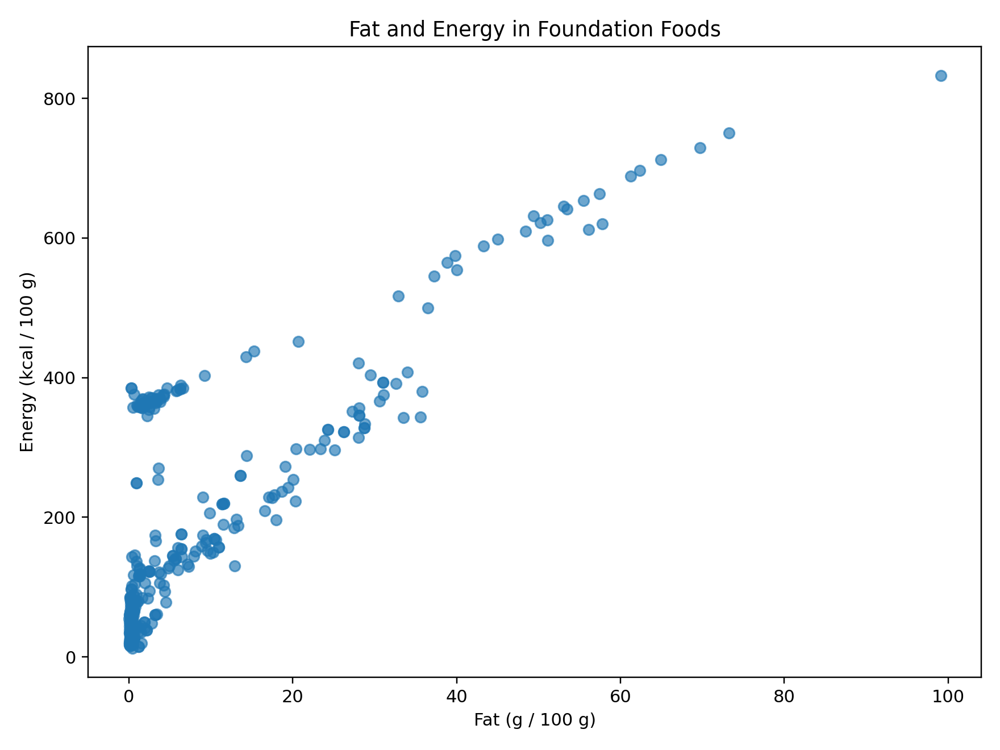
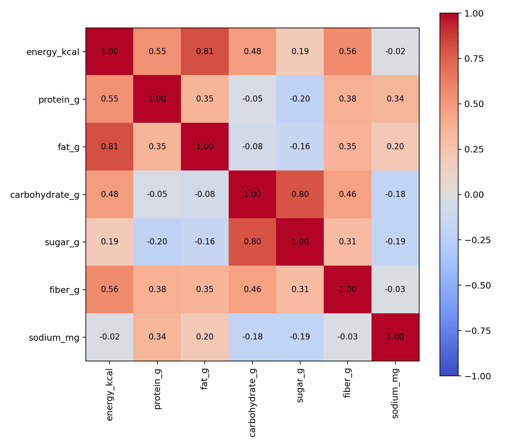
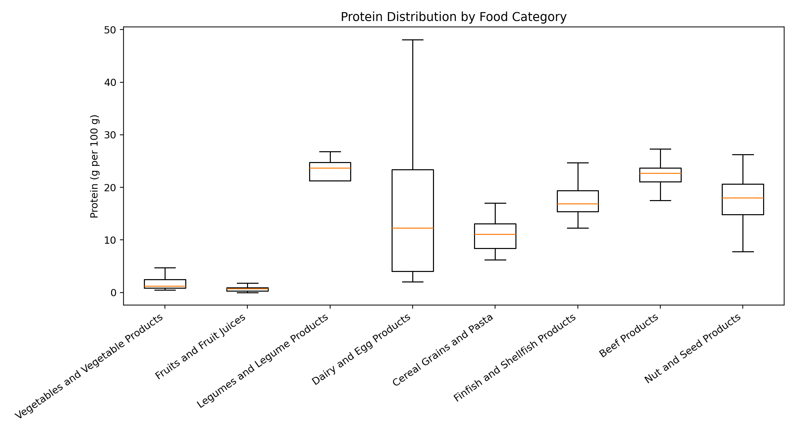
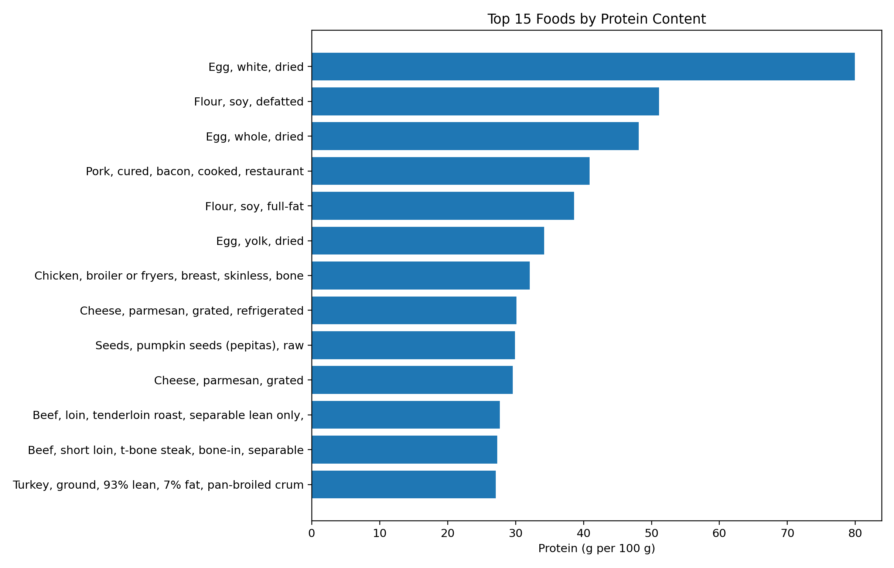
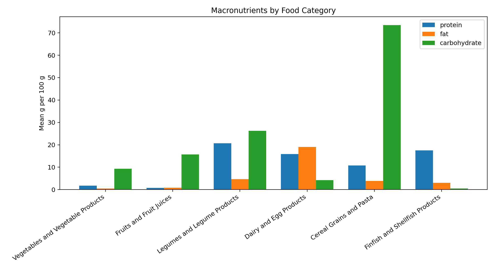

# Food Nutrient Profiling and Exploratory Data Analysis

**Independent food science and Python project** | USDA FoodData Central Foundation Foods, April 2026

## Overview

This project analyzes the composition of foods using publicly available nutrient data. It connects undergraduate training in Food Quality and Safety with Python-based data handling, exploratory statistics, and visualization. It does **not** infer individual dietary intake or disease risk.

## Dataset

- Source: [USDA FoodData Central, download datasets](https://fdc.nal.usda.gov/download-datasets/)
- Release: **Foundation Foods, April 2026 (CSV)**
- Analysis subset: **469 Foundation Food records across 19 food categories** (as counted from the supplied archive)
- Analysis unit: individual `fdc_id` food entries; nutrient values reported per 100 g when present.
- Nutrients: energy, protein, fat, carbohydrate, total sugar, dietary fiber, sodium.
- Missing values remain missing; missing does not mean zero.
- The script combines USDA energy IDs 1008, 2047, 2048 in that priority order, recording the method in `energy_source`. These are not identical definitions of energy.

## Workflow

1. Read the official `food.csv`, `food_category.csv`, and `food_nutrient.csv` tables from the ZIP.
2. Keep only `data_type == "foundation_food"` records.
3. Join category labels and pivot selected nutrient measurements into one record per food.
4. Audit nutrient completeness, describe distributions and correlations, and compare categories.
5. Generate PNG figures and CSV tables.

## Selected results

The analysis covers **469 foods in 19 categories**. Availability varies substantially among nutrients. Rankings are per 100 g and are not equivalent to dietary or clinical recommendations.

### Nutrient data completeness


### Energy density vs. fat


### Nutrient correlations


### Protein content across categories


### Highest protein foods in this subset


### Mean macronutrients by category


## Repository structure

```text
food-nutrition-eda/
├── README.md
├── requirements.txt
├── .gitignore
├── run.py
├── data/
│   ├── README.md
│   └── usda_foundation_2026.zip
└── results/
    ├── figures/             # 6 PNG plots
    └── tables/              # 3 CSV outputs
```

## Reproduce locally (Windows / VS Code)

Open the `food-nutrition-eda` folder in VS Code. In Terminal → New Terminal, run:

```powershell
py -m venv .venv
.venv\Scripts\python.exe -m pip install -r requirements.txt
.venv\Scripts\python.exe run.py
```

You should see a completion message and the figures/tables in `results/`. Run from the repository root, not inside `data`.

## Limitations

- USDA Foundation Foods is a selected inventory, not a representative sample of all foods or diets.
- Nutrient coverage is uneven. Means and correlations reflect nonmissing recorded foods.
- Energy values can originate from different calculation factors and are not strictly harmonized.
- Category rankings are descriptive and may be sensitive to which foods are present.
- Food composition alone cannot establish disease risk or causal health effects.

## Data acknowledgment

USDA Agricultural Research Service, [FoodData Central](https://fdc.nal.usda.gov/). Source release: Foundation Foods, April 2026 (CSV). Please consult USDA metadata for individual sampling/measurement methods.

**Educational and research-training project; not dietary or clinical advice.**
